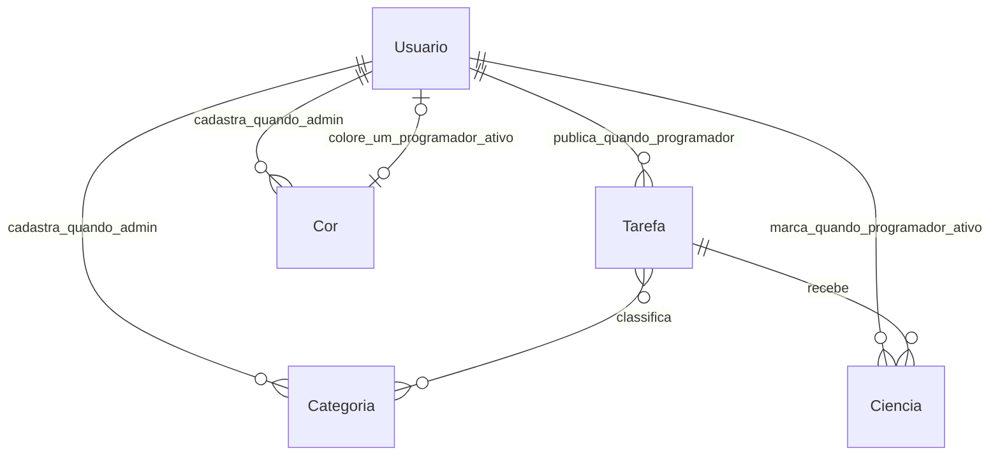

# Glossário e modelo conceitual

**Usuario** é o model de conta do produto. **Admin** e **Programador** são papéis **disjuntos** desse usuário (ver ESP-05).

## Glossário

| Termo | Definição |
| --- | --- |
| **Usuario** | Conta de acesso ao produto (conta própria do AutoDaily, não usuário genérico de framework). Carrega username, senha e papel (admin ou programador). |
| **Programador** | Papel de membro ativo que publica a própria tarefa, edita o próprio card, marca e desmarca ciência nas tarefas dos outros. **Desativado:** não entra no programa (login recusado), não aparece no mural, não marca ciência e não entra no time de agora. |
| **Admin** | Papel disjunto de programador. Registra e edita membros, desativa e reativa, redefine senha, cadastra e exclui categorias, exclui qualquer tarefa. Sem card no mural e sem ciência. Primeiro admin nasce por **comando de linha do produto**. |
| **Tarefa atual** | A que o card mostra na parede. |
| **Tarefa anterior / histórico** | Papel guardado quando um novo foi publicado ou quando deixou de ser o exibido no card. Conserva dados; tarefa guardada congela ciência e denominador ao sair da parede. |
| **Exclusão definitiva** | Tarefa removida de verdade: some do histórico e dos relatórios; não é desativação; não volta. |
| **Card em branco com opção de retornar** | Após excluir a tarefa atual, o card fica vazio; se houver tarefa guardada, o programador pode acionar retorno da mais recente (vira atual de novo; ver ESP-01 e ESP-02). |
| **Card** | Lugar fixo do programador ativo no mural. Apresentação da tarefa atual (ou vazio). Programador desativado não tem card visível no mural. |
| **Descrição** | Texto breve do programador unindo negócio e código. Único campo obrigatório na publicação. |
| **Id do Trello** | Identificador informado no card. Opcional na publicação. Não implica integração. Várias tarefas podem repetir o mesmo id. |
| **Categoria** | Registro opcional no card. Face usa a primeira em ordem alfabética e “Nome e mais...” se houver outras. Só admin cria e apaga categoria. Apagar tira a categoria dos cards. |
| **Cor** | Registro do admin (nome e hex) que um programador ativo escolhe para o próprio post-it. Exclusiva entre ativos. Sem escolha, o card fica no papel cinza. |
| **Ciência** | Marcação de programador ativo (não autor, não admin) dizendo que tomou conhecimento. Pode ser desmarcada pelo próprio. Visual de taxinha; a cabeça usa a cor de quem marcou. Ordem alfabética do nome no card. |
| **Barra de progresso** | No topo do card: preenchimento percentual normativo; texto interno **x/y**. Fundo 30% mais claro que a cor do post-it; enchimento 30% mais escuro. |
| **Insígnia** | Sinal sóbrio no canto superior direito quando x = y (todas as ciências esperadas marcadas). |
| **Relatório simples** | Quantidades quebradas por programador e por dia. O recorte é a data de publicação. Qualquer autenticado emite. |
| **Relatório completo** | Além do simples: quebra por id do Trello, duração por tarefa, tempo médio, leitura de ciência. Categoria só é mostrada, sem contagem por categoria (ESP-04). |

## Modelo conceitual

Entidades: **Usuario** (papéis Admin e Programador), **Tarefa**, **Categoria**, **Ciencia**, **Cor**.

Relações:

- Usuario com papel Programador publica zero ou mais Tarefas; no máximo uma delas é a exibida como atual no card (**RF-002**). Exclusão da atual deixa card em branco; retorno explícito repõe a guardada mais recente como atual.
- Usuario com papel Admin não publica Tarefa.
- Programador pode estar ativo ou desativado (estado do membro).
- Tarefa tem zero ou mais Categorias (vínculo N:N).
- Ciencia liga um Programador ativo a uma Tarefa que ele não autorou. Admin não marca Ciencia.
- Programador ativo escolhe no máximo uma Cor. Admin cadastra Cor e não a usa como post-it.
- Uma Tarefa é **atual na parede** ou **guardada**.

Não incluir atributos inventados (prioridade, prazo, estimativa, status de workflow).

Este diagrama é **conceitual**. Não é schema de banco nem migration. **Não autoriza** model de framework nem schema SQL como substituto do domínio descrito aqui. **Admin** e **Programador** são papéis disjuntos do **Usuario**, não entidades separadas obrigatórias no schema futuro.
